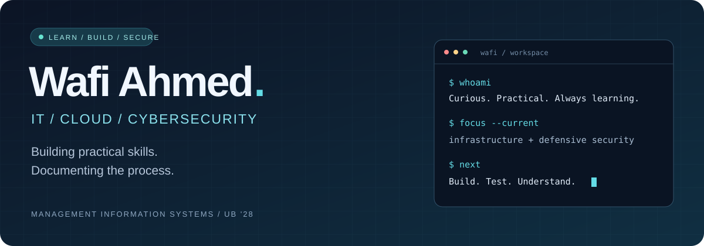
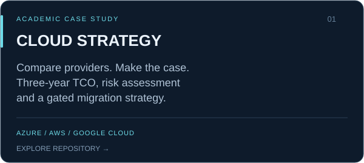
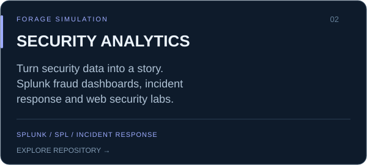
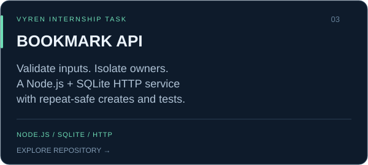
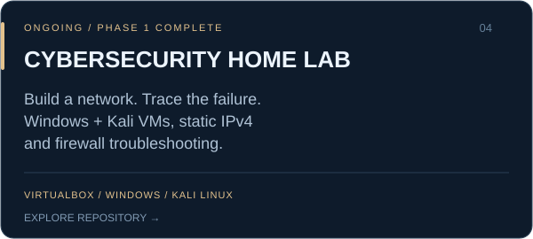

  

  <a href="#selected-work">Selected work</a> &nbsp; / &nbsp;
  <a href="#toolkit--focus">Toolkit &amp; focus</a> &nbsp; / &nbsp;
  <a href="https://www.linkedin.com/in/yaqub-ahmed/">LinkedIn</a>

## Hey, I'm Wafi.

I'm **Yaqub Wafi Ahmed**, a University at Buffalo student pursuing a **B.S. in Business Administration with a concentration in Management Information Systems**, with graduation planned for **May 2028**.

I'm interested in how systems work, how they fail, and how to make them more reliable and secure. This is where I share my projects, technical write-ups, and hands-on learning across **IT infrastructure, cloud, cybersecurity, and backend development**.

**Seeking Summer 2027 internships** in IT support, infrastructure, cloud, and cybersecurity.

## Selected work

<table>
  <tr>
    <td width="50%">
      
    </td>
    <td width="50%">
      
    </td>
  </tr>
  <tr>
    <td width="50%">
      
    </td>
    <td width="50%">
      
    </td>
  </tr>
</table>

**More work:** [Cyber risk and ransomware response simulation](https://github.com/YWA0987/datacom-cyber-security-operations-simulation) · [Python automation in a cybersecurity simulation](https://github.com/YWA0987/aig-cybersecurity-simulation) · [Computer vision for masjid parking availability — in progress](https://github.com/YWA0987/AI-powered-parking-detection)

Forage projects are educational job simulations, not employment with the named organizations. The cloud evaluation is an academic case study with modeled estimates.

## Toolkit & focus

| Area | Tools and concepts I'm practicing |
| :--- | :--- |
| **Security analysis** | Splunk · SPL · Incident analysis · Risk assessment · Security documentation |
| **Infrastructure & cloud** | VirtualBox · Windows / Kali Linux · IPv4 networking · Windows Firewall · Azure / AWS / Google Cloud evaluation · RTO / RPO · Migration planning |
| **Development** | Python · JavaScript · Node.js · SQLite · HTTP APIs · Input validation · Integration tests |
| **Technical communication** | Case studies · Decision matrices · Troubleshooting notes · Business impact analysis |

### What I'm working toward

- Building a stronger foundation in networking, systems, and defensive security.
- Connecting technical decisions to business risk, cost, and operational needs.
- Writing documentation that makes my work easy to understand and reproduce.

---

  <strong>Understand the system. Test the assumptions. Document the work.</strong> 
  Let's connect on <a href="https://www.linkedin.com/in/yaqub-ahmed/">LinkedIn</a>.

